```{r setup, include=FALSE}
options(htmltools.dir.version = FALSE)
knitr::opts_chunk$set(
  fig.width=9, fig.height=3.5, fig.retina=3,
  out.width = "100%",
  cache = FALSE,
  echo = TRUE,
  message = FALSE, 
  warning = FALSE,
  hiline = TRUE
)
```

```{r xaringan-themer, include=FALSE, warning=FALSE}
library(xaringanthemer)
style_duo_accent(
  primary_color = "#af1313",
  secondary_color = "#a48484",
  inverse_header_color = "#FFFFFF",
  base_font_size = "25px"
)
```


name: colors

## Quem sou eu?

.left-column[

]

.right-column[
- Graduação, mestrado, doutorado e livre-docência em Estatística pelo IME-USP;

- Professor no IME-USP (desde 2013);

- Professor no DEs-UFSCar (2011-2012);

- PROTOC-IPq-HCFMUSP (2006-2011) e PROVE-Unifesp (2007-2011);

- Fui coordenador do Bacharelado em Estatística (2022-2025)

<!-- , membro da CoC-BE e do Conselho do Departamento; -->

- Gosto de cozinhar, praticar esportes (vôlei, futebol, skate, corrida, musculação), toco instrumentos musicais, brinco de marcenaria e conserto coisas...

]

---

## Quem sou eu?

<!-- .left-column[ -->
.pull-left[
- 53 artigos completos publicados em periódicos;

- 4 capítulos de livros;

- Mais de 80 trabalhos apresentados em congressos;

- Orientei 6 doutorados, 8 iniciações científicas e mais de 25 TCCs (principalmente CEA);

- Atualmente, oriento quatro doutorados, dois mestrados e duas iniciações científicas.

]

<!-- .right-column[ -->
.pull-right[
```{r, echo=FALSE, out.width='95%', fig.align='center', fig.cap=''}
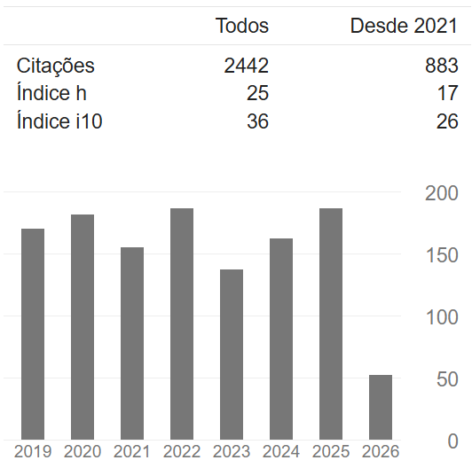
```
]


---

## Principais Áreas de Pesquisa

1. Inferência Bayesiana;

1. Teoria da Decisão;

1. Fundamentos de Probabilidade e Estatística:

  * Fundamentos de Testes de Hipóteses;

1. Estatística Computacional e R!

1. Aplicações em diversas áreas:

  * Psiquiatria, Medicina, Arqueologia, Biologia, Esporte, entre outras...

---

### Fundamentos de Testes de Hipóteses

.small[
1. Cavaliere, Y.F.; Esteves, L.G.; Fossaluza, V. An axiomatic development of Pereira-Stern e-value as a measure of support for statistical hypotheses. *International Journal of Approximate Reasoning*, p. 109622, 2025.

1. Flórez Rivera, A.F.; Esteves, L.G.; Fossaluza, V.; Pereira, C.A.B. On The Nuisance Parameter Elimination Principle In Hypothesis Testing. *Entropy*, V. 26, P. 117, 2024.

1. Patiño Hoyos, A.E.; Fossaluza, V.; Esteves, L.G.; Pereira, C.A.B. Adaptive Significance Levels In Tests For Linear Regression Models: The E-Value And P-Value Cases. *Entropy*, V. 25, P. 19, 2023.

1. Pereira, C.A.B.; Nakano, E.Y.; Fossaluza, V.; Esteves, L.G.; Gannon, M.; Polpo, A. Hypothesis Tests For Bernoulli Experiments: Ordering The Sample Space By Bayes Factors And Using Adaptive Significance Levels For Decisions. *Entropy*, V. 19, P. 696, 2017.

1. Fossaluza, V.; Izbicki, R.; Da Silva, G.M.; Esteves, L.G. Coherent Hypothesis Testing. *The American Statistician*, 2016.

1. Da Silva, G.M.; Esteves, L.G.; Fossaluza, V.; Izbicki, R.; Wechsler, S. A Bayesian Decision-Theoretic Approach To Logically-Consistent Hypothesis Testing. *Entropy*, V. 17, P. 6534-6559, 2015.

1. Izbicki, R.; Fossaluza, V.; Hounie, A.G.; Nakano, E.Y.; Pereira, C.A.B. Testing Allele Homogeneity: The Problem Of Nested Hypotheses. *BMC Genetics*, V. 13, P. 103, 2012.
]

---

### Alocação Intencional e Estimação de Distribuições

.small[
1. Fumis, A.A.F.; Fossaluza, V.; Stern, R.B. Covariate balance under Bayesian decision theory. *arXiv preprint* arXiv:2509.01828, 2025. 

1. Diniz, J.B.; Fossaluza, V.; Pereira, C.A.B.; Wechsler, S. Rain Dance: The Role Of Randomization In Clinical Trials. *Open Access Journal Of Clinical Trials*, V. 8, P. 21-32, 2016.

1. Fossaluza, V.; Lauretto, M.S.; Pereira, C.A.B.; Stern, J.M. Combining Optimization and Randomization Approaches for the Design of Clinical Trials. *Springer Proceedings in Mathematics & Statistics*. 1ªed.: Springer International Publishing, 2015, v. 118, p. 173-184.

1. Fossaluza, V.; Diniz, J.B.; Pereira, B.B.; Miguel, E.C.; Pereira, C.A.B. Sequential Allocation To Balance Prognostic Factors In A Psychiatric Clinical Trial. *Clinics*, V. 64, P. 511-518, 2009.

---

1. Fossaluza, V.; Esteves, L.G.; Pereira, C.A.B. Estimating Multivariate Discrete Distributions Using Bernstein Copulas. *Entropy*, V. 20, P. 194, 2018.

1. Ferreira, L.A.; Fossaluza, V. The Random Bernstein Polynomial Smoothing Via ABC Method. *Springer Proceedings in Mathematics & Statistics*. 1ed.: Springer International Publishing, p. 123-129, 2018.

]

---

#### Alocação Intencional

```{r, echo=FALSE, out.width='50%', fig.align='center', fig.cap=''}
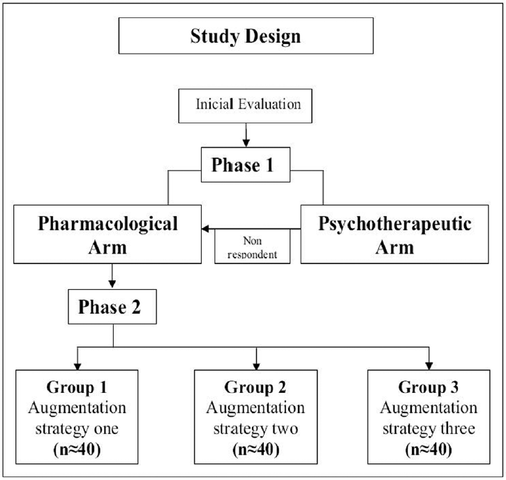
```

---

#### Alocação Intencional

```{r, echo=FALSE, out.width='90%', fig.align='center', fig.cap=''}
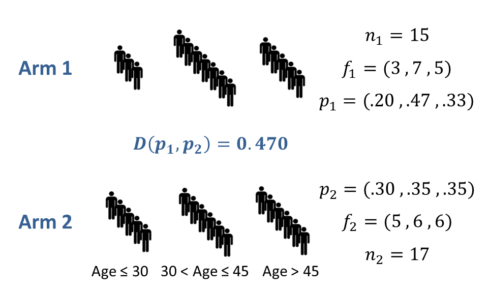
```

---

#### Alocação Intencional

```{r, echo=FALSE, out.width='90%', fig.align='center', fig.cap=''}
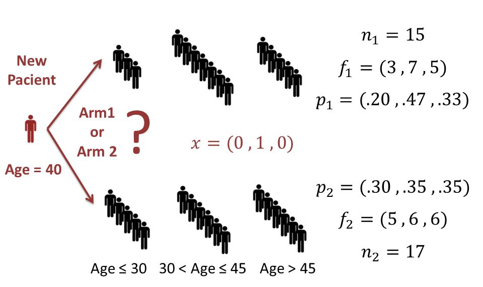
```

---

#### Alocação Intencional

```{r, echo=FALSE, out.width='90%', fig.align='center', fig.cap=''}
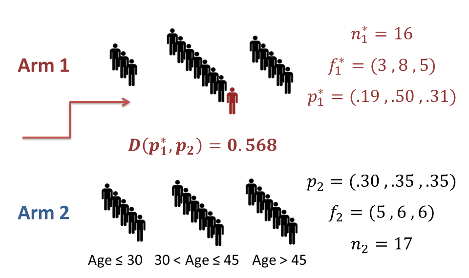
```

---

#### Alocação Intencional

```{r, echo=FALSE, out.width='90%', fig.align='center', fig.cap=''}
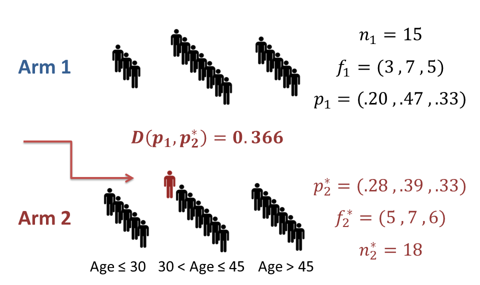
```

---

#### Alocação Intencional

```{r, echo=FALSE, out.width='90%', fig.align='center', fig.cap=''}
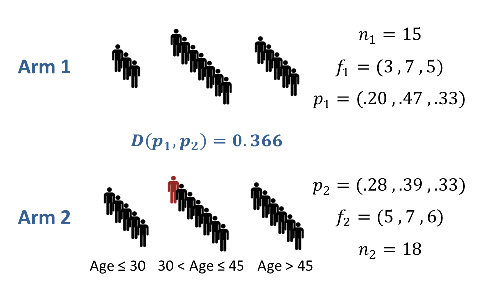
```

---

#### Alocação Intencional

```{r, echo=FALSE, out.width='90%', fig.align='center', fig.cap=''}
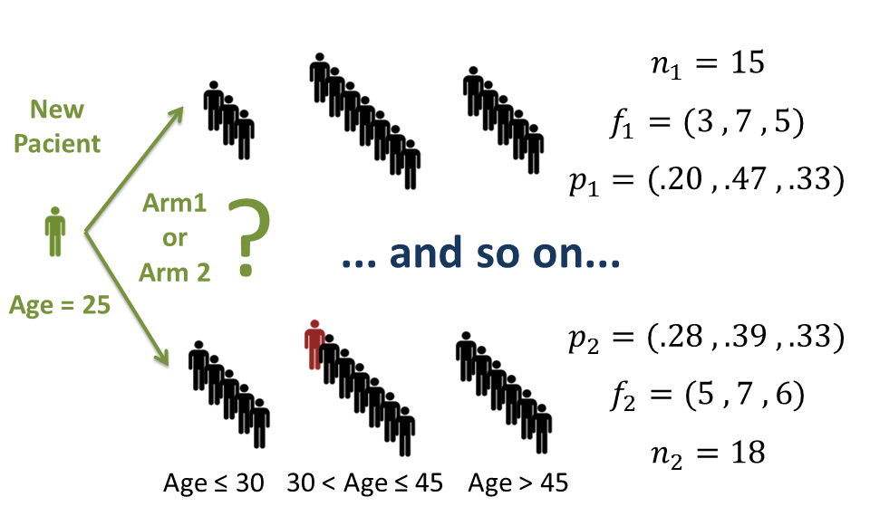
```

---

#### Alocação Intencional

```{r, echo=FALSE, out.width='60%', fig.align='center', fig.cap=''}
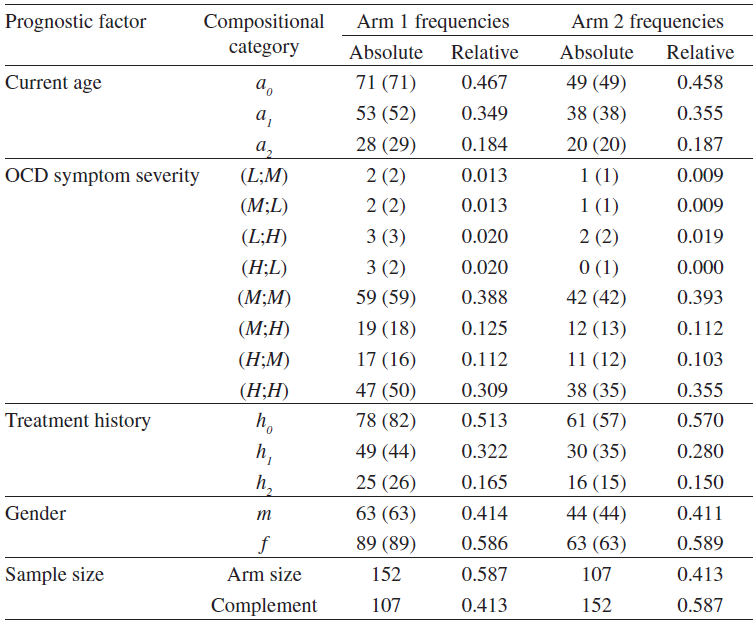
```

---

#### Alocação Intencional

```{r, echo=FALSE, out.width='50%', fig.align='center', fig.cap=''}
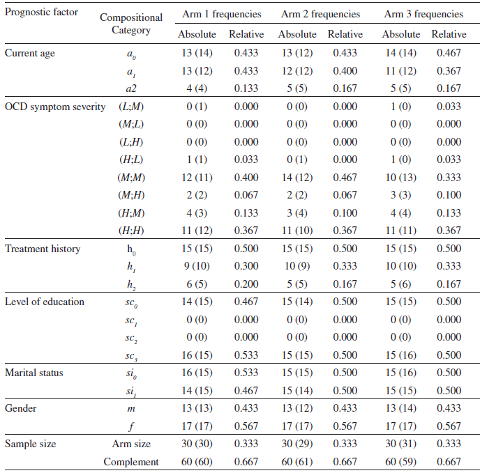
```

---

#### Alocação Intencional

```{r, echo=FALSE, out.width='65%', fig.align='center', fig.cap=''}
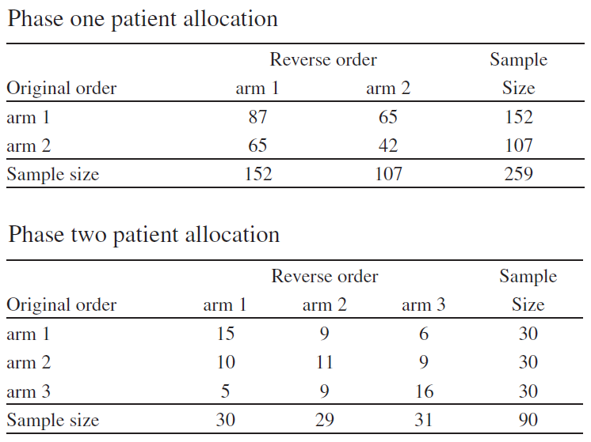
```

---

### Aplicações de Inferência Bayesiana

.small[
1. Moura, M.L.; Boszczowski, I.; Blaque, M.; Mussarelli, R.M.; Fossaluza, V.; Pierrotti, L.C.; Campana, G.; Brandileone, M.C.; Zanella, R.; Almeida, S.C.G.; Levin, A.S. Effect On Antimicrobial Resistance Of A Policy Restricting Over-The-Counter Antimicrobial Sales In A Large Metropolitan Area, São Paulo, Brazil. *Emerging Infectious Diseases*, V. 28, P. 180-187, 2022.

1. Mimicos, E.V.; Fossaluza, V.; Picone, C.M.; De Sena, C.C.; Gomes, H.R.; Lázari, C.S.; Silva, F.F.; Nakanishi, E.S.; Nisida, I.V.; Freitas, A.C.; Gryschek, R.B.; Lagonegro, E.R.; Lazéra, M.; Shikanai-Yasuda, M.A. Prevalence And Associated Factors Of Cryptococcal Antigenemia In HIV-Infected Patients With Cd4 < 200 Cells/ml In São Paulo, Brazil: A Bayesian Analysis. *Journal Of Fungi*, V. 8, P. 1284, 2022.

1. Oliveira, M.C.; Soreira, A.; Fossaluza, V. Classifying the Origin of Archeological Fragments with Bayesian Networks. *Springer Proceedings in Mathematics & Statistics*. 1a ed.: Springer International Publishing, 2015, v. 118, p. 291-300.
]

---

#### Resistência de Báctérias a Antibióticos

```{r, echo=FALSE, out.width='55%', fig.align='center', fig.cap=''}
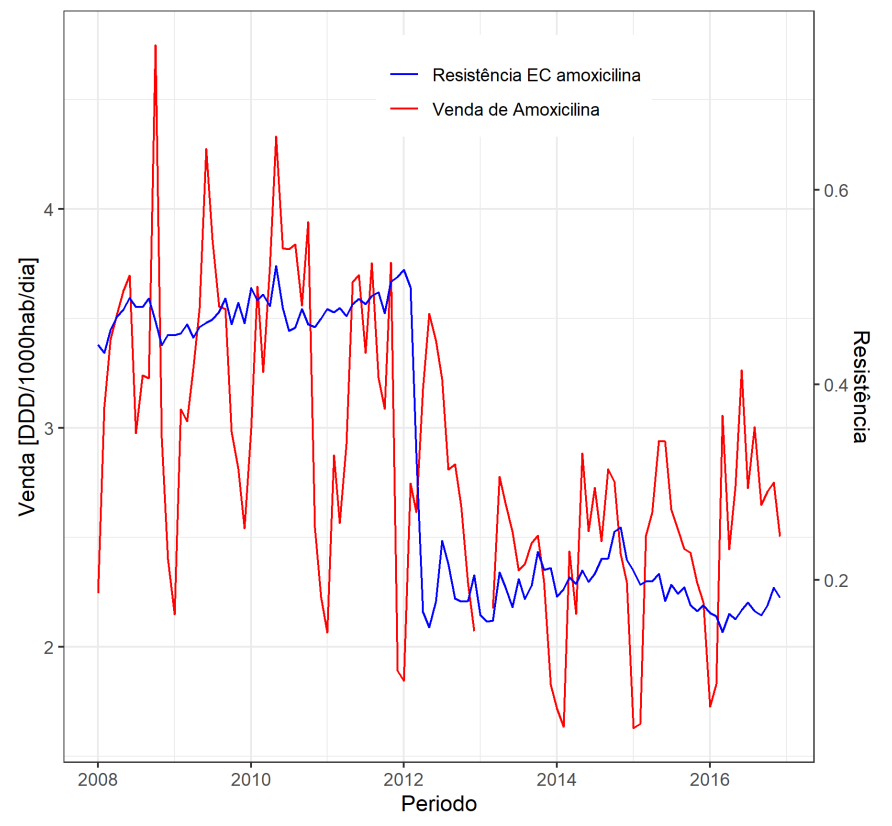
```

---

#### Resistência de Báctérias a Antibióticos

- $(Y_t-\bar{Y}_0) = \beta_t(X_t-\bar{X}_0) + \epsilon_t~~~;~~~~~\beta_{t+1} = \beta_t + \eta_t$

.pull-left[
```{r, echo=FALSE, out.width='100%', fig.align='center',fig.cap=''}
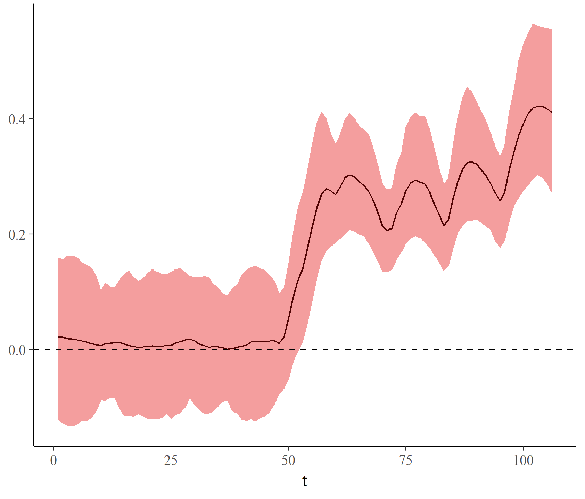
```
]

.pull-right[
```{r, echo=FALSE, out.width='100%', fig.align='center',fig.cap=''}
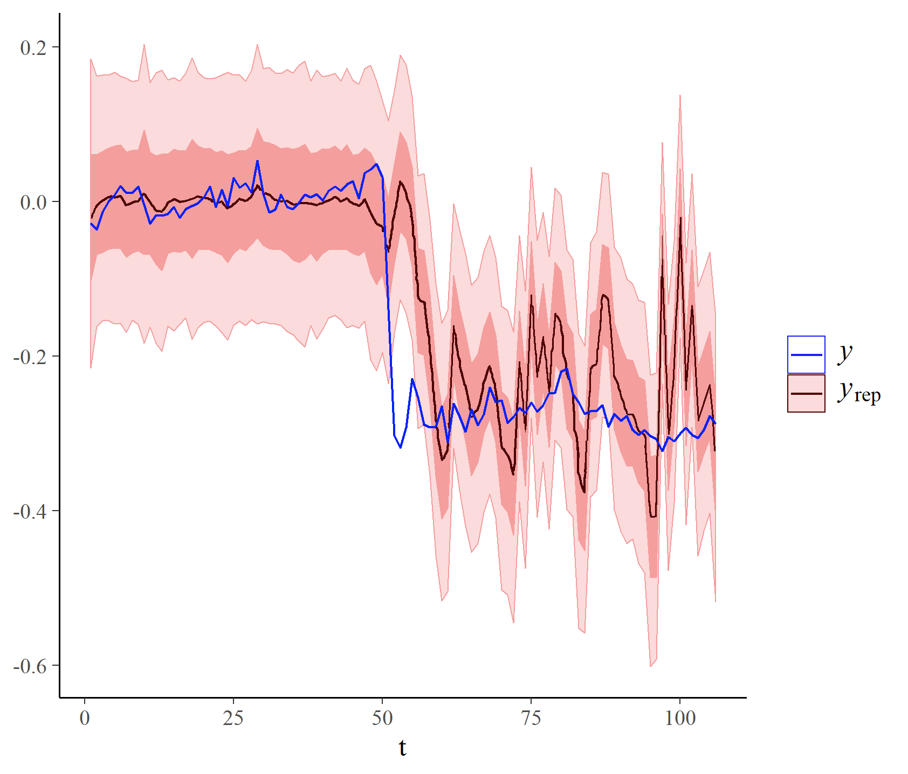
```
]

---

#### Priori Meta-Analítica
- $\theta \sim \text{beta}\left(1+\sum x_i~,~ 1+\sum (n_i-x_i)\right)$

```{r, echo=FALSE, out.width='90%', fig.align='center', fig.cap=''}
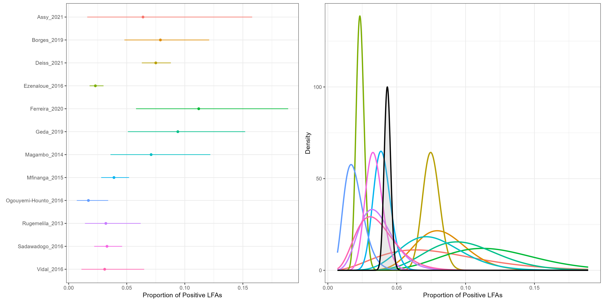
```

---

#### Priori Meta-Analítica
- $f(\theta) = \sum w_i~f_i(\theta)~~;~~~~f_i(\theta)\sim\text{beta}(1+x_i~,~1+n_i-x_i)$

```{r, echo=FALSE, out.width='90%', fig.align='center', fig.cap=''}
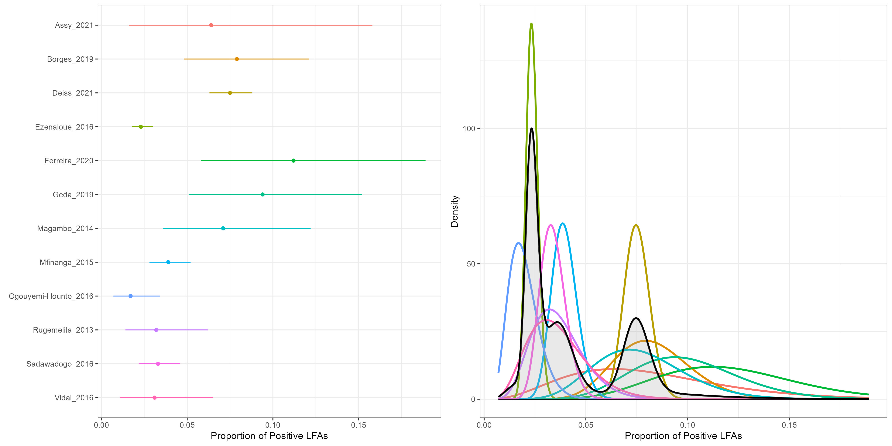
```

---

#### Classificação de Artefatos Usando Redes Bayesianas

.pull-left[
```{r, echo=FALSE, out.width='90%', fig.align='center',fig.cap=''}
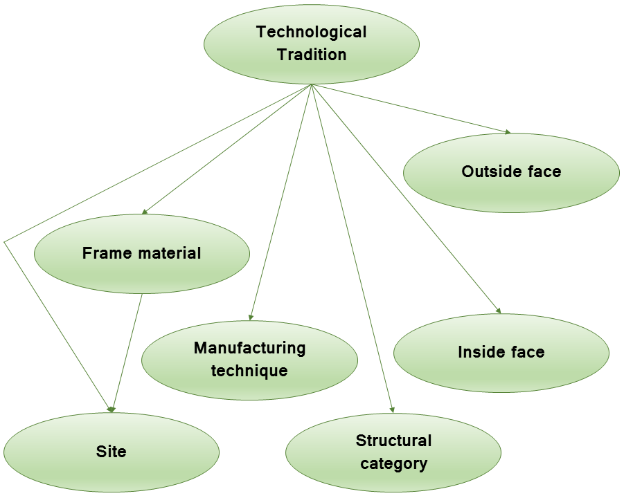
```
]

.pull-right[
```{r, echo=FALSE, out.width='100%', fig.align='center',fig.cap=''}
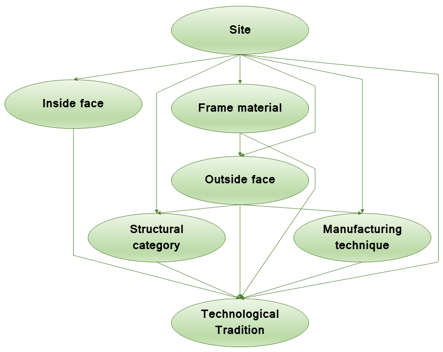
```
]

---

### Contatos


.left-column[

]

.right-column[
**Victor Fossaluza**

- e-mail: victorf@ime.usp.br

- site: www.ime.usp.br/~victorf/

- instagram: @victor_ime
]